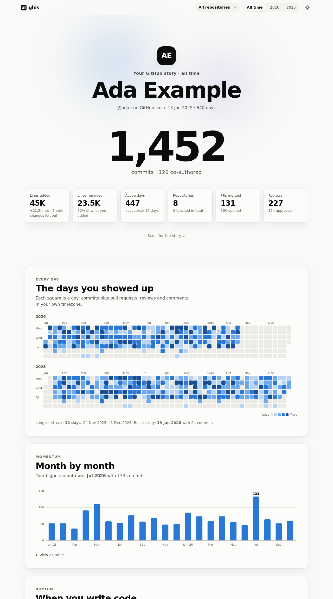
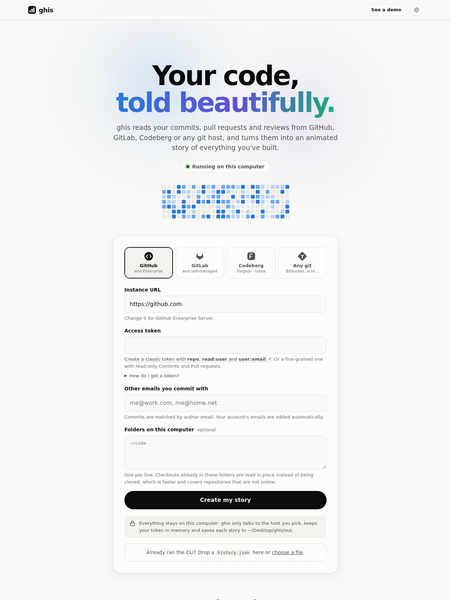
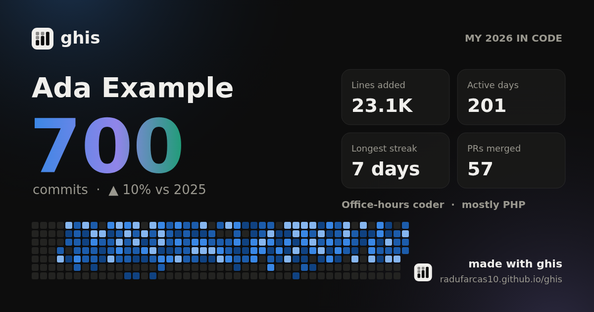

# ghis

**Your git history, told beautifully.**

[Website and live demo →](https://radufarcas10.github.io/ghis/)

ghis reads your commits, pull/merge requests and reviews from GitHub, GitLab, Codeberg or
any git host, and turns them into an animated story page: a day-by-day calendar, your coding
rhythm, where your time went, languages, collaboration stats and highlights.



- **Nothing to install** beyond Python and git. No packages, no build step, no account.
- **Runs on your computer** by default. Your token and code never leave it.
- **Works everywhere**: GitHub (and Enterprise), GitLab (and self-managed),
  Codeberg / Forgejo / Gitea, and any other host by clone URL or local folder.
- **Can be hosted** for a team or the public with Docker. See [Hosting](#hosting-ghis-for-others).

## Quick start

You need **Python 3.9+** and **git 2.31+**. Check with `python3 --version` and `git --version`.

```bash
git clone https://github.com/radufarcas10/ghis.git
cd ghis
python3 ghis.py        # on Windows: py ghis.py
```

It works the same on Linux, macOS and Windows. Two things differ:

- **Windows** runs Python as `py` (or `python`), not `python3`. Install git from
  [git-scm.com](https://git-scm.com) if you don't have it.
- **macOS** may ask whether Terminal can open your Desktop, Documents or Downloads folders
  the first time ghis looks for checkouts. Allow it, or checkouts there won't be found. The app
  opens at `localhost` instead of `ghis.localhost`, because Safari doesn't resolve `.localhost` names.

Your browser opens at <http://ghis.localhost:8080>, or the next free port if another app uses 8080.
(On a Mac it opens <http://localhost:8080>: Safari does not resolve `.localhost` names.)



1. **Pick where your code lives.** ghis immediately looks around your computer and shows
   what it found:
   - the repositories in your home folder,
   - every email you have committed with (matched by your git `user.name`),
   - your instance, read from your remotes (for example a company GitLab),
   - a token you already have: `$GITHUB_TOKEN` / `$GITLAB_TOKEN` / `$GITEA_TOKEN`, the
     `gh` or `glab` CLI, or git's credential helper. It is checked with the host and
     never shown in the page.
2. **Click Create my story.** That's it. You will see live progress, then the story opens.
   A copy is saved to `out/index.html` so you can reopen it any time, even offline.

Without a token you get a story from your local repositories. To also include pull/merge
requests, reviews and repositories you never cloned, paste a token. Click **How do I get a
token?** under the field for step-by-step instructions: the link opens your host's token page
with the right scopes already ticked.

Just want to look first? `python3 ghis.py demo --open` shows a story built from sample data,
and the project website has live demos.

**Prefer a command?** `pipx install git+https://github.com/radufarcas10/ghis` gives you `ghis`,
which works the same as `python3 ghis.py` (stories and clones then live in `~/.ghis`).

Press `Ctrl+C` in the terminal to stop ghis.

## What's in a story

- **Every day you showed up:** a calendar per year, your longest and current streaks.
- **Momentum and rhythm:** commits month by month, and the hours and weekdays you code.
- **Where and what:** repositories and languages, by commits and lines changed.
- **Collaboration and people:** pull/merge requests, time to merge, reviews, and who you
  review most and who reviews you (GitHub and GitLab).
- **Highlights and milestones:** your biggest commit, your 1,000th, first commits to each
  repository, anniversaries.
- **Explore:** filter by year and by repository. A year is compared with the same days of the
  year before ("▲ 12% vs 2025").
- **Share:** download a 1200×630 image of your highlights. It has no repository names, commit
  messages or emails on it. **Share-safe data** gives a copy of the whole story with messages
  removed and repositories and teammates renamed.



## Where it can read from

| Source | Adds on top of commits | Token scopes |
|---|---|---|
| **GitHub** (github.com, Enterprise Server) | PRs, reviews, approvals | classic: `repo`, `read:user`, `user:email`, or fine-grained with read-only *Contents* and *Pull requests* |
| **GitLab** (gitlab.com, self-managed) | MRs, reviews, approvals, comments, activity | `read_api`, `read_user`, `read_repository` |
| **Codeberg / Forgejo / Gitea** | PRs, reviews, approvals, comments, activity | read: *user*, *repository*, *issue* |
| **Any git host** (Bitbucket, Sourcehut, Azure DevOps, your server, local folders) | none | only for private HTTPS repositories |

How it counts:

- **Commits come from real clones** (`git log --numstat` across all branches), matched by
  **author email**. Provider accounts contribute their emails automatically. Add any others
  you have used.
- **Lines** exclude lockfiles, `dist/`, `vendor/`, `node_modules/`, minified files and test
  snapshots, so one `npm install` does not dwarf a year of work. Their commits still count.
- **Co-authored commits** count too: a commit whose `Co-authored-by:` trailer names one of
  your emails is yours as well (pair programming, suggested changes).
- **Copies count once.** A commit that was rebased or cherry-picked onto another branch, or
  pushed to a fork, has a new id but the same author, author time and message, so it is
  recognized as the same change.
- **Bulk changes** (an import, a vendored library, a formatter run) are commits bigger than
  2,000 lines and 40 times your typical commit. They count as commits, but their lines are
  left out of line totals and languages, and the story lists them separately.
- **It won't match your GitHub, GitLab or Codeberg profile exactly.** Profiles count
  differently, often only the default branch and only the last year, and include repositories
  ghis never saw. Every story ends with **What this story covers**: each repository and how
  current it is, the emails matched, and anything left out.
- **Times** are shown in the timezone you committed from. Review and comment activity is moved
  into that same timezone, so it lands on the right day.
- **Only what it needs is downloaded.** ghis never downloads anyone else's files. Where
  your commits are a small part of a long history, it downloads the bare list of commits
  and then only the snapshots and files your commits touched. Otherwise it downloads the
  history without files, then your files. A host that supports neither gets a full clone.
  The numbers are identical every way. Repositories are read as each one arrives, while
  the rest download.
- **Nothing is left behind.** Downloads go to a temporary folder that is deleted when the
  story is built, even if it fails or you stop it. The story itself is saved to `out/`.
  To make later stories faster, tick **Keep downloaded repositories** in the app (or pass
  `--keep-clones`): they stay in `cache/`, and the next run only fetches what changed.
  Untick it, and the next story deletes them.

## Using the command line

Everything the app does is also available as a command, which suits scripts and cron jobs.

```bash
# GitHub, GitLab or Codeberg: put the token in the environment
# (Windows PowerShell: $env:GITHUB_TOKEN="..."; py ghis.py collect --provider github --open)
GITHUB_TOKEN=... python3 ghis.py collect --provider github --open
GITLAB_TOKEN=... python3 ghis.py collect --provider gitlab --url https://gitlab.example.com --open
GITEA_TOKEN=...  python3 ghis.py collect --provider gitea --url https://codeberg.org --open

# Any host, no API: clone URLs and/or folders of checkouts
python3 ghis.py collect --provider git --email you@example.com \
  --repo https://bitbucket.org/team/app.git --local-root ~/code --open
```

Useful flags (all are listed under `python3 ghis.py collect --help`):

| Flag | Does |
|---|---|
| `--email ADDR` | add an author email to match (repeatable) |
| `--exclude-email ADDR` | leave out an email that isn't yours, e.g. a teammate who shares your git name (repeatable) |
| `--local-root DIR` | read checkouts under `DIR` in place instead of cloning (repeatable) |
| `--clone-via https` | clone with the token instead of your SSH keys (default: `ssh`) |
| `--keep-clones` | keep downloaded repositories in `cache/` so the next run only fetches what changed (`ghis serve` takes it too) |
| `--all-member-projects` | include every repository you can access, not just the ones you contributed to |
| `--count-all-files` | count lockfile, build and vendored lines too |
| `--token-file PATH` | read the token from a file instead of the environment |
| `--insecure` | accept a self-signed TLS certificate on a self-hosted instance |

Output goes to `out/`. Open `out/index.html` directly from disk. `out/history.json` holds
the raw data: upload it to any ghis server, or run `python3 ghis.py render` to rebuild the
page after changing it, without collecting again.

## Hosting ghis for others

Run ghis as a web app that colleagues or the public open in their browser:

```bash
git clone https://github.com/radufarcas10/ghis.git && cd ghis
docker compose up --build      # http://localhost:8080
```

When ghis is reachable by others, it switches to **hosted mode**:

- It only contacts hosts on an allowlist and only clones over HTTPS.
- Local folders and SSH are disabled.
- Clones are deleted after each job, and stories expire.
- Visitors can also upload a `history.json` made with the CLI. That is how to include
  instances the server cannot reach.

There is no published image: you build your own from the source you cloned, so you know
exactly what runs. It works on any container host (a VPS, Fly.io, Render, Railway, Cloud Run,
Kubernetes). To run it on several servers, push your build to your own registry:

```bash
docker build -t registry.example.com/team/ghis:1 . && docker push registry.example.com/team/ghis:1
```

### Deploy for your team

[`deploy/`](deploy/) runs ghis on your own domain over HTTPS, behind a login, with one
command. It pairs ghis with [Caddy](https://caddyserver.com), which obtains and renews the
certificate itself. On a server whose DNS name points at it, with ports 80 and 443 open:

```bash
git clone https://github.com/radufarcas10/ghis.git && cd ghis
cp deploy/.env.example deploy/.env       # set the domain, login and your instance
docker compose -f deploy/compose.yml up -d --build
```

To update later, `git pull` and run the last command again.

For a company GitLab at `gitlab.example.com`, `deploy/.env` would hold:

```bash
GHIS_DOMAIN=stories.example.com
GHIS_LOGIN=team
GHIS_PASSWORD_HASH='$2a$14$...'           # docker run --rm caddy:2 caddy hash-password
GHIS_ALLOWED_HOSTS=gitlab.example.com
GHIS_DEFAULT_PROVIDER=gitlab
GHIS_DEFAULT_URL=https://gitlab.example.com
```

Everyone then opens `https://stories.example.com`, signs in, and finds the form already
pointed at your GitLab. They only paste their own token.

### Settings

Each setting is an environment variable, or the `ghis serve` flag in brackets.

| Setting | Does | Default |
|---|---|---|
| `GHIS_PUBLIC_URL` (`--public-url`) | The address people open, such as `https://stories.example.com`. Set it whenever ghis is behind a proxy. | none |
| `GHIS_ALLOWED_HOSTS` | Hosts the server may call. Add your self-hosted instance, or use `*` on a private network. | `github.com,gitlab.com,codeberg.org,bitbucket.org,git.sr.ht` |
| `GHIS_DEFAULT_PROVIDER` | The provider the form starts on: `github`, `gitlab`, `gitea` or `git`. | `github` |
| `GHIS_DEFAULT_URL` | The instance the form starts with. Needs `GHIS_DEFAULT_PROVIDER`, and its host must be allowed. | the provider's public site |
| `GHIS_CA_FILE` (`--ca-file`) | A PEM file of extra certificate authorities to trust, for an instance with an internal certificate. The system's own stay trusted. | none |
| `GHIS_MAX_JOBS` | How many stories are built at once. The rest wait in line. | `2` |
| `GHIS_TTL_MINUTES` | How long a finished story stays available. | `60` |
| `GHIS_MAX_STORIES` | Stories held at once. New ones are refused beyond it. | `200` |
| `GHIS_GIT_TIMEOUT` | Seconds one clone or scan may take. | `600` |
| `PORT` | The port to listen on. | `8080` |

A setting that makes no sense, such as a default instance that isn't allowed, stops ghis at
startup with the reason rather than failing later for a visitor. `GHIS_CA_FILE` works for
the command line too (`ghis collect --ca-file company-ca.pem`).

### Behind your own proxy

Already run nginx, Traefik or a load balancer? Point it at port 8080 and set
`GHIS_PUBLIC_URL`. ghis compares it with the browser's `Origin` to block cross-site requests.
Without it, the comparison uses the `Host` header, which many proxies rewrite. "Create my
story" then fails with a 403.

```nginx
server {
    server_name stories.example.com;
    # listen 443 ssl; plus your certificate lines
    client_max_body_size 64m;    # history.json uploads; nginx allows 1 MB by default
    location / {
        proxy_pass http://127.0.0.1:8080;
        proxy_read_timeout 300s;
    }
}
```

To serve it under a path such as `https://example.com/ghis/`, strip the prefix in the proxy:
with nginx, `location /ghis/ { proxy_pass http://127.0.0.1:8080/; }`, and with Caddy,
`handle_path /ghis/* { reverse_proxy ghis:8080 }`. The pages use only relative links, so
nothing else changes. Use the address with its trailing slash.

### Who can use it

ghis has no accounts of its own: anyone who can reach it can build a story, using their own
token. Decide who that should be:

- **Your team only:** the login in `deploy/Caddyfile`, a single sign-on proxy such as
  [oauth2-proxy](https://oauth2-proxy.github.io/oauth2-proxy/), Cloudflare Access or
  Tailscale. Leave `/healthz` open for health checks.
- **The public:** HTTPS (people paste tokens into it), a short allowlist, and a
  rate-limiting proxy.

Either way, give it enough temporary disk for clones (`/tmp`, 4 GB in the compose files) and
run a **single replica**. Stories live in that process's memory, so a restart forgets them,
which suits stories that expire anyway. [SECURITY.md](SECURITY.md) describes the guarantees
in detail.

## Troubleshooting

**"0 commits" or fewer than expected.** Commits are matched by author email. In one of
your repositories, run `git log --format='%ae' | sort | uniq -c | sort -rn` to see which
emails you used, then add the missing ones.

**A repository failed to clone.** The story still builds, and the failures are listed
under *notes about this data* at the bottom. On the command line, try `--clone-via https`.
If the repository is checked out locally, point `--local-root` (or the folders field) at it.

**GitHub organization repositories are missing.** If the organization uses SAML SSO,
authorize the token for it: *Settings → Developer settings → Tokens → Configure SSO*.

**The calendar starts later than my first commit.** GitLab deletes old activity events.
Commits themselves are unaffected.

**Port 8080 is taken.** ghis moves to the next free port by itself and prints the address it
uses. To choose one yourself, run `python3 ghis.py serve --port 9000 --open`.

**`certificate verify failed`** on a self-hosted instance: on the command line, add
`--insecure`. Better still, install the instance's CA certificate.

## Privacy

Running on your computer, ghis talks only to the host you choose, and deletes the
repositories it downloads as soon as the story is built. The generated `out/` folder (and
`cache/`, if you use `--keep-clones`) contains your private history and is ignored by git.
Think before you share a `history.json` or a printed story: they include commit messages
and repository names.

## License

[MIT](LICENSE) © 2026 Radu Farcas

## Development

```bash
python3 -m unittest discover tests      # Python, server and headless-browser tests
node --test tests/js/*.test.js          # the story page's logic
ruff check . && ruff format --check .   # lint
```

The code is a package under `src/ghis/` (the `ghis.py` at the top only launches it), the
pages are in `src/ghis/web/`, and the project website is in `site/`. CI runs every check above
plus a Docker smoke test, and the Pages workflow publishes the site with its live demos.

## Contributing

Issues and pull requests are welcome. [CONTRIBUTING.md](CONTRIBUTING.md) covers the
layout, the tests and how to add a provider. Report security issues privately, as
described in [SECURITY.md](SECURITY.md).
